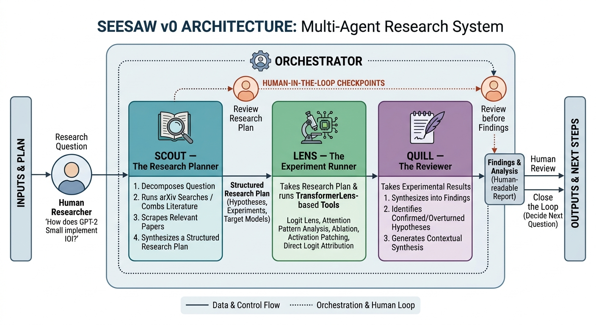

<div align="center">

# Seesaw

**Accessible, pragmatic interpretability.**

[](LICENSE)
[](pyproject.toml)
[](https://github.com/langchain-ai/langgraph)
[](https://modelcontextprotocol.io)

[Setup & Usage Docs](DOCS.md) · [When to use it](#when-youd-use-it) · [Pathways](#pathways) · [Architecture](#architecture) · [Blog](https://mindsandai.substack.com)

</div>

<br>

<p align="center">
  
</p>

<br>

## Overview

Models show unexpected behaviors at every stage of development, and interpretability has proven useful for finding them. But new models arrive faster than experts can study them. Seesaw uses AI agents to automate interpretability: diagnose a behavior you've seen, screen a model before you ship it, compare two versions after a change, and understand why your model behaves the way it does. Newcomers get answers they can act on, and researchers get through more models, faster.

<div align="center">

**Scout** `behavior + examples → plan` → **Lens** `plan → results bundle` → **Quill** `bundle → critique report`

</div>

You describe the behavior in a sentence, with a few prompts where the model does it and a few where it doesn't, and choose to monitor, audit or fix it. Scout picks one of eight **pathways**, fixed investigations that end in a verdict and are each checked against a known answer, and writes its inputs from your examples. You approve both before anything runs on a model. Lens runs the pathway on any TransformerLens model, and Quill critiques the result.

Every result is labelled with how strong its evidence is (correlational, estimate, or causal) and whether its controls ran. Each agent can also run on its own as an [MCP](https://modelcontextprotocol.io) server; see [DOCS.md](DOCS.md).

<br>

## Quick Start

```bash
uv venv .venv --python 3.12 && source .venv/bin/activate
uv pip install -e ".[experiments]"   # Lens needs torch + TransformerLens

cp .env.example .env                 # set ANTHROPIC_API_KEY (and HF_TOKEN for Gemma or Llama)
seesaw doctor                        # checks keys, model access, memory, torch and the job store
```

Then describe a behavior whose answer is already known, so you can check the verdict. A job starts from what the model does, in a sentence, with a real prompt where it does it and the closest one where it doesn't:

```bash
seesaw jobs submit "Uses the gender a job title implies to choose 'she' or 'he'" \
  --example "The nurse said that" --non-example "The person said that" \
  --pathway concept_direction --model Qwen/Qwen2.5-1.5B --follow
```

`--follow` streams the job's log and asks you to approve at each gate: once for Scout's plan and inputs, once before Quill critiques the results. The job runs on your machine and is stored in a local SQLite file. Qwen2.5 is open, so this needs no Hugging Face token. It's also the default model when you leave out `--model`. Gemma and Llama are gated: accept the license on Hugging Face and set `HF_TOKEN`, then run `seesaw doctor --model google/gemma-2-2b` to check access. Artifacts land in `outputs/jobs/<id>/`.

Leave out `--pathway` and Scout chooses one (or none, and plans the experiments itself). Add `--search` to let Scout search arXiv and the web while it plans; this needs `FIRECRAWL_API_KEY` for web search.

**[docs/use-cases.md](docs/use-cases.md)** lists sample questions for each pathway, with the ★ known-answer ones to start with. Full setup, the CLI reference, and deployment notes are in **[DOCS.md](DOCS.md)**.

<br>

## The `seesaw` command

| Command | Does |
|---|---|
| `seesaw doctor [--model M]` | Check this machine is ready: keys, model access, memory and disk, torch, the job store |
| `seesaw jobs submit "<behavior>"` | Start a job on a behavior: Scout → gate → Lens → gate → Quill. `--example`, `--non-example`, `--action`, `--behavior-file`, `--pathway`, `--model`, `--search`, `--auto-approve`, `--follow` |
| `seesaw jobs list` / `show` / `logs` | See jobs, their status and artifacts, and the worker's log |
| `seesaw jobs approve` / `retry` / `cancel` | Drive a job: clear a gate, re-run a failed stage, stop it |
| `seesaw jobs rerun <id> [--model M]` | Run a job's pathway again on its approved inputs, from Lens, optionally on another model |
| `seesaw run "<question>"` | The whole pipeline in your terminal, with no job record and no pathway |
| `seesaw plan "<question>"` · `seesaw critique <bundle.json>` | Scout only, or Quill only |
| `seesaw use-cases [--json PATH]` | What Seesaw is for: each use case's metric, baseline, pathway and status |
| `seesaw eval <task>` · `seesaw fixtures` | The eval suite, and the meta-eval that checks its graders |

The dashboard ([seesaw-web](https://github.com/vijpandaturtle/seesaw-web)) reads the same job store when it's Postgres (`DATABASE_URL`), so a job started in one shows in the other. Jobs in the local SQLite file don't show there. Set the same `SEESAW_DB_SCHEMA` on both sides to keep trial jobs apart from the live ones.

<br>

## When you'd use it

| Moment | You bring | You get | Status |
|---|---|---|---|
| **Diagnose:** you saw it do something | The behavior, a few prompts where it happens and where it doesn't, your model; then monitor, audit or fix | A verdict against the simple option (a text classifier, a better prompt), and the detector or fix when it wins | Monitor runs end to end; audit and fix don't yet run the comparison |
| **Screen:** before you ship it | Your model, and the behaviors to screen for | An audit of each: is it there, and where does it come from | Each behavior runs as its own job; only prompt injection has a dataset and pass/fail rule |
| **Compare:** after you change it | The model before and after, and the behavior you're worried about | Where the two versions differ on it (`model_diffing`) | Rerunning earlier checks on the new version isn't built yet |

Every outcome is scored against the best way to do the same job without interpretability, so a result says whether looking inside the model actually helped. The full list of safety jobs, with each one's metric, baseline and status, including the planned ones, is in [`seesaw/use_cases.py`](seesaw/use_cases.py); `seesaw use-cases` prints it.

## Pathways

Pathways are the methods Scout chooses from.

| Purpose | Pathway | What it does |
|---|---|---|
| Understand a capability | `circuit_discovery` | Nominates heads, verifies heads and MLPs by patching, and checks the circuit is faithful |
| Find and steer a concept | `concept_direction` | Fits a concept direction on half the pairs, then removes and steers it on the other half against random directions |
| Build a detector | `probe_monitor` | Trains probes, picks a layer, and tests on held-out texts against shuffled labels, an embeddings-only probe, and bag-of-words |
| Audit a spurious dependence | `spurious_audit` | Measures how much an attribute moves the answer, then erases it with LEACE and checks the task survives |
| Locate a fact | `factual_recall` | Causal tracing over layers and positions |
| Edit a fact | `editing_comparison` | ROME edits at every layer, compared with the traced layer |
| Diff two models | `model_diffing` | Per-prompt KL, which tokens the change favours, and which component's weights account for it |
| Explain an output | `feature_explain` | Sweeps published SAEs for the features that drive the answer (Gemma-2-2B or Qwen2.5-7B-Instruct) |

The pathways are deterministic, and their random baselines are seeded. A rerun of a job gives the same verdict on the same model and inputs. Their inputs are defined in [`seesaw/pathways/catalog.py`](seesaw/pathways/catalog.py), and the known-answer checks, run on Gemma-2-2B, Llama-3.2-1B and Qwen2.5-1.5B, are in [`tests/test_pathways_models.py`](tests/test_pathways_models.py).

<br>

## Agents

The agents currently run on Claude.

<table>
<tr>
<td width="33%" valign="top">

### 🔭 Scout
**The Research Planner**

Turns a question into a research plan: it chooses a pathway and its inputs, or plans free-form experiments when no pathway fits. The plan includes hypotheses, the target model, and extra experiments. Literature search over arXiv and the web is opt-in (`--search`).

**Tools**
`search_arxiv` · `search_arxiv_web` · `search_web` · `scrape_url` · `save_research_plan`

**Stack**
LangGraph ReAct · Firecrawl

</td>
<td width="33%" valign="top">

### 🔬 Lens
**The Experiment Runner**

Runs the plan: the pathway first, then any extra experiments, then an LLM interpretation of each result. Lens has 18 tools for text models, grouped by the evidence they give:

| Kind | Tools |
|---|---|
| Descriptive | `logit_lens` · `attention_pattern` · `direct_logit_attribution` · `linear_probe` · `feature_search` · `counterfactual` |
| Estimate (nominates) | `attribution_patching` · `feature_attribution` · `edge_attribution_patching` · `circuit_tracing` |
| Causal (verifies) | `ablation` · `activation_patching` · `head_patching` · `circuit_evaluation` · `path_patching` · `steering_vector` · `directional_ablation` · `feature_clamping` |

With `SEESAW_INTERP_BACKEND=lever`, Lens runs six tools on vision-language models instead (LLaVA, Qwen-VL, CLIP). Full catalog: [`shared/lens_tools.py`](shared/lens_tools.py).

**Stack**
LangGraph StateGraph · TransformerLens · SAELens · Neuronpedia

</td>
<td width="33%" valign="top">

### 🪶 Quill
**The Reviewer**

Reviews the results bundle like a peer reviewer, treating the pathway's verdict as the primary evidence. It flags methodological issues, unsupported conclusions, and missing experiments, and writes follow-up specs Lens can run directly.

**Stack**
LangGraph StateGraph

</td>
</tr>
</table>

<br>

## Architecture

Every agent shares the same internal structure — `app/`, `config/`, `models/`, `tools/`, `routers/`, `resources/`, `prompts/`, `server.py` — so the codebase reads consistently whether you're in Scout, Lens, or Quill. Details in [DOCS.md](DOCS.md#directory-structure).

The pipeline is deliberately simple: a fixed-order **prompt-chaining workflow**, not autonomous multi-agent routing. Scout always runs first, Lens second, Quill third, and no agent decides who runs next. That keeps the system predictable and easy to debug.

The interpretability code is a plain library, separate from the agents: `seesaw.interp` holds the tools and `seesaw.pathways` holds the pathways. You can call either from a notebook without any agent; see [DOCS.md](DOCS.md#library-api).

<br>

## Motivation

Most mechanistic interpretability work is done by hand — identify a circuit, ablate it, write it up. Seesaw is an experiment in automating that research loop, with the goal of accelerating exploratory safety research on small models.

<br>

## License

[Apache 2.0](LICENSE)
