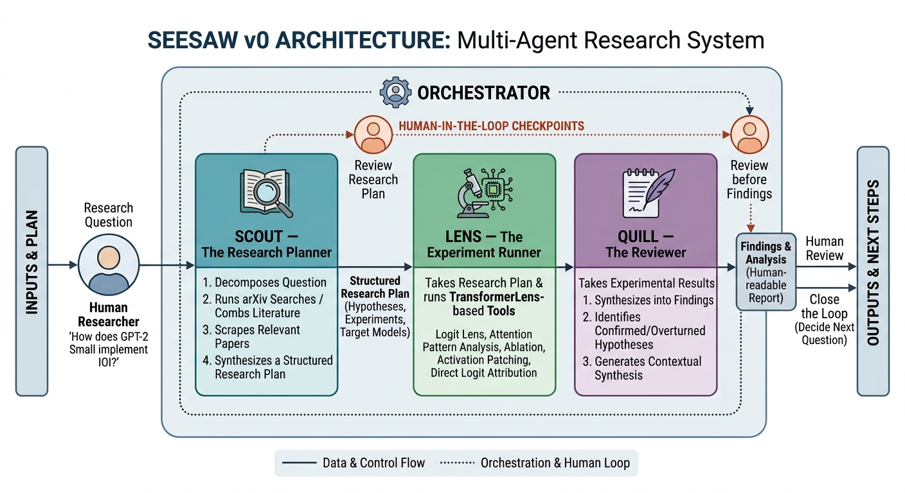

<div align="center">

# Seesaw

**A multi-agent framework for automated interpretability research on AI safety problems**

[](LICENSE)
[](pyproject.toml)
[](https://github.com/langchain-ai/langgraph)
[](https://modelcontextprotocol.io)

[Setup & Usage Docs](DOCS.md) · [Use cases](#use-cases) · [Sample questions](docs/use-cases.md) · [Pathways](#pathways) · [Architecture](#architecture) · [Blog](https://mindsandai.substack.com)

</div>

<br>

<p align="center">
  
</p>

<br>

## Overview

Seesaw automates the hypothesis → experiment → critique loop in mechanistic interpretability, aimed at AI safety jobs: monitoring a model for unsafe behavior, auditing it for hidden problems, and fixing what's found. You ask a question; three agents handle the rest.

<div align="center">

**Scout** `question → research plan` → **Lens** `plan → results bundle` → **Quill** `bundle → critique report`

</div>

Most questions don't need a free-form plan. Seesaw ships eight **pathways**: fixed, hand-coded investigations that end in a verdict, each checked against a known answer. They run on any TransformerLens model. Scout picks the pathway that fits your question and chooses its inputs. You approve both before anything runs on a model. Lens runs the pathway, and Quill critiques the result.

Every result is labelled with how strong its evidence is (correlational, estimate, or causal) and whether its controls ran. Each agent can also run on its own as an [MCP](https://modelcontextprotocol.io) server; see [DOCS.md](DOCS.md).

<br>

## Quick Start

```bash
uv venv .venv --python 3.12 && source .venv/bin/activate
uv pip install -e ".[experiments]"   # Lens needs torch + TransformerLens

cp .env.example .env                 # set ANTHROPIC_API_KEY (and HF_TOKEN for Gemma or Llama)
seesaw doctor                        # checks keys, model access, memory, torch and the job store
```

Then ask a question whose answer is already known, so you can check the verdict:

```bash
seesaw jobs submit "Does the model use the gender a job title implies to choose 'she' or 'he'?" \
  --pathway concept_direction --model Qwen/Qwen2.5-1.5B --follow
```

`--follow` streams the job's log and asks you to approve at each gate: once for Scout's plan and inputs, once before Quill critiques the results. The job runs on your machine and is stored in a local SQLite file. Qwen2.5 is open, so this needs no Hugging Face token. It's also the default model when you leave out `--model`. Gemma and Llama are gated: accept the license on Hugging Face and set `HF_TOKEN`, then run `seesaw doctor --model google/gemma-2-2b` to check access. Artifacts land in `outputs/jobs/<id>/`.

Leave out `--pathway` and Scout chooses one (or none, and plans the experiments itself). Add `--search` to let Scout search arXiv and the web while it plans; this needs `FIRECRAWL_API_KEY` for web search.

**[docs/use-cases.md](docs/use-cases.md)** lists sample questions for each pathway, with the ★ known-answer ones to start with. Full setup, the CLI reference, and deployment notes are in **[DOCS.md](DOCS.md)**.

<br>

## The `seesaw` command

| Command | Does |
|---|---|
| `seesaw doctor [--model M]` | Check this machine is ready: keys, model access, memory and disk, torch, the job store |
| `seesaw jobs submit "<question>"` | Start a research job: Scout → gate → Lens → gate → Quill. `--pathway`, `--model`, `--search`, `--auto-approve`, `--follow` |
| `seesaw jobs list` / `show` / `logs` | See jobs, their status and artifacts, and the worker's log |
| `seesaw jobs approve` / `retry` / `cancel` | Drive a job: clear a gate, re-run a failed stage, stop it |
| `seesaw jobs rerun <id> [--model M]` | Run a job's pathway again on its approved inputs, from Lens, optionally on another model |
| `seesaw run "<question>"` | The whole pipeline in your terminal, with no job record and no pathway |
| `seesaw plan "<question>"` · `seesaw critique <bundle.json>` | Scout only, or Quill only |
| `seesaw use-cases [--json PATH]` | What Seesaw is for: each use case's metric, baseline, pathway and status |
| `seesaw eval <task>` · `seesaw fixtures` | The eval suite, and the meta-eval that checks its graders |

The dashboard ([seesaw-web](https://github.com/vijpandaturtle/seesaw-web)) reads the same job store when it's Postgres (`DATABASE_URL`), so a job started in one shows in the other. Jobs in the local SQLite file don't show there. Set the same `SEESAW_DB_SCHEMA` on both sides to keep trial jobs apart from the live ones.

<br>

## Use cases

Seesaw is organized around AI safety jobs, not techniques. Each use case is scored by an outcome metric and compared with the best way to do the job without interpretability, so a result says whether looking inside the model actually helped. The catalog is [`seesaw/use_cases.py`](seesaw/use_cases.py); `seesaw use-cases` lists it, and `seesaw jobs submit --use-case <name>` runs one.

| Goal | Use case | Outcome metric | Baseline without interp | Pathway | Status |
|---|---|---|---|---|---|
| Monitor | Build a safety monitor (deception, prompt injection, harmful intent) | Held-out accuracy of an activation probe | Bag-of-words and embeddings-only probes | `probe_monitor` | Runnable |
| Monitor | Check reasoning faithfulness | Stated reason matches what the answer depends on | Counterfactual prompt edits, output only | — | Planned |
| Audit | Find failure modes | Distinct failures found under a query budget, and their severity | Black-box red-teaming and fuzzing | — | Planned |
| Audit | Find a backdoor | Trigger identified, and in how many queries | Black-box red-teaming | — | Planned |
| Audit | Audit a hidden objective | Names the planted goal or behavior | Behavioral testing and prompting | — | Planned |
| Audit | Detect sandbagging | Tells sandbagging models from honest ones, with few false alarms | Elicitation by fine-tuning or few-shot prompting | — | Planned |
| Audit | Audit a fine-tune | Recall of a planted change, and false alarms | Comparing outputs on eval sets | `model_diffing` | Baseline missing |
| Fix | Steer away from unsafe behavior (sycophancy, bias) | Targeted change vs. collateral damage | Prompting, safety fine-tuning | `concept_direction` | Baseline missing |
| Fix | Remove a spurious correlation | Accuracy on a balanced or shifted test set | Fine-tuning or reweighting on rebalanced data | `spurious_audit` | Baseline missing |
| Fix | Edit or unlearn knowledge | Forgetting the target vs. ability kept elsewhere | Gradient-ascent unlearning, fine-tuning | `editing_comparison` | Baseline missing |
| Fix (vision) | Resist prompt injection in images | Accuracy on attacked vs. clean images | Prompting, light fine-tune | lever tools | Planned |
| Fix (vision) | Reduce object hallucination | Accuracy on yes/no object questions | Prompting, contrastive decoding | lever tools | Planned |
| Fix (vision) | Remove a spurious background | Worst-group accuracy (Waterbirds) | Group reweighting, retraining the head | lever tools | Planned |

"Baseline missing" means the pathway does the job but doesn't yet run the baseline arm or score the outcome metric, so its verdict doesn't answer the use case on its own. Most of the planned audits need model organisms: small models with a planted backdoor, objective or hidden capability, so an audit can be scored against the plant. Three more entries cover understanding a model, with no outcome to beat: understand a capability (`circuit_discovery`), locate a fact (`factual_recall`) and explain an output (`feature_explain`).

## Pathways

Pathways are the methods use cases run.

| Purpose | Pathway | What it does |
|---|---|---|
| Understand a capability | `circuit_discovery` | Nominates heads, verifies heads and MLPs by patching, and checks the circuit is faithful |
| Find and steer a concept | `concept_direction` | Fits a concept direction on half the pairs, then removes and steers it on the other half against random directions |
| Build a detector | `probe_monitor` | Trains probes, picks a layer, and tests on held-out texts against shuffled labels, an embeddings-only probe, and bag-of-words |
| Audit a spurious dependence | `spurious_audit` | Measures how much an attribute moves the answer, then erases it with LEACE and checks the task survives |
| Locate a fact | `factual_recall` | Causal tracing over layers and positions |
| Edit a fact | `editing_comparison` | ROME edits at every layer, compared with the traced layer |
| Diff two models | `model_diffing` | Per-prompt KL, which tokens the change favours, and which component's weights account for it |
| Explain an output | `feature_explain` | Sweeps published SAEs for the features that drive the answer (Gemma-2-2B or Qwen2.5-7B-Instruct) |

The pathways are deterministic, and their random baselines are seeded. A rerun of a job gives the same verdict on the same model and inputs. Their inputs are defined in [`seesaw/pathways/catalog.py`](seesaw/pathways/catalog.py), and the known-answer checks, run on Gemma-2-2B, Llama-3.2-1B and Qwen2.5-1.5B, are in [`tests/test_pathways_models.py`](tests/test_pathways_models.py).

<br>

## Agents

The agents currently run on Claude.

<table>
<tr>
<td width="33%" valign="top">

### 🔭 Scout
**The Research Planner**

Turns a question into a research plan: it chooses a pathway and its inputs, or plans free-form experiments when no pathway fits. The plan includes hypotheses, the target model, and extra experiments. Literature search over arXiv and the web is opt-in (`--search`).

**Tools**
`search_arxiv` · `search_arxiv_web` · `search_web` · `scrape_url` · `save_research_plan`

**Stack**
LangGraph ReAct · Firecrawl

</td>
<td width="33%" valign="top">

### 🔬 Lens
**The Experiment Runner**

Runs the plan: the pathway first, then any extra experiments, then an LLM interpretation of each result. Lens has 18 tools for text models, grouped by the evidence they give:

| Kind | Tools |
|---|---|
| Descriptive | `logit_lens` · `attention_pattern` · `direct_logit_attribution` · `linear_probe` · `feature_search` · `counterfactual` |
| Estimate (nominates) | `attribution_patching` · `feature_attribution` · `edge_attribution_patching` · `circuit_tracing` |
| Causal (verifies) | `ablation` · `activation_patching` · `head_patching` · `circuit_evaluation` · `path_patching` · `steering_vector` · `directional_ablation` · `feature_clamping` |

With `SEESAW_INTERP_BACKEND=lever`, Lens runs six tools on vision-language models instead (LLaVA, Qwen-VL, CLIP). Full catalog: [`shared/lens_tools.py`](shared/lens_tools.py).

**Stack**
LangGraph StateGraph · TransformerLens · SAELens · Neuronpedia

</td>
<td width="33%" valign="top">

### 🪶 Quill
**The Reviewer**

Reviews the results bundle like a peer reviewer, treating the pathway's verdict as the primary evidence. It flags methodological issues, unsupported conclusions, and missing experiments, and writes follow-up specs Lens can run directly.

**Stack**
LangGraph StateGraph

</td>
</tr>
</table>

<br>

## Architecture

Every agent shares the same internal structure — `app/`, `config/`, `models/`, `tools/`, `routers/`, `resources/`, `prompts/`, `server.py` — so the codebase reads consistently whether you're in Scout, Lens, or Quill. Details in [DOCS.md](DOCS.md#directory-structure).

The pipeline is deliberately simple: a fixed-order **prompt-chaining workflow**, not autonomous multi-agent routing. Scout always runs first, Lens second, Quill third, and no agent decides who runs next. That keeps the system predictable and easy to debug.

The interpretability code is a plain library, separate from the agents: `seesaw.interp` holds the tools and `seesaw.pathways` holds the pathways. You can call either from a notebook without any agent; see [DOCS.md](DOCS.md#library-api).

<br>

## Motivation

Most mechanistic interpretability work is done by hand — identify a circuit, ablate it, write it up. Seesaw is an experiment in automating that research loop, with the goal of accelerating exploratory safety research on small models.

<br>

## License

[Apache 2.0](LICENSE)
