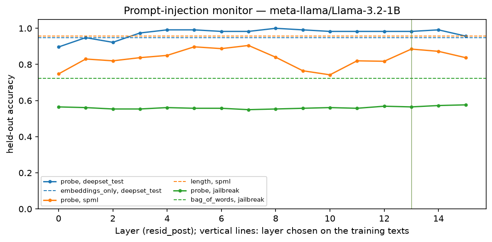

# Does a probe on the activations make a better prompt-injection monitor?

**Use case:** `build_a_safety_monitor` · **Run:** 2026-11-09 to 2026-11-13 · **Harness:** [`seesaw/benchmarks/safety_monitor.py`](../../seesaw/benchmarks/safety_monitor.py)

## Answer

No, not on these models and data. Across three models and three test sets, the activation probe never beats the best classifier that reads only the text by the margin set before the run. On the training distribution it scores 96–99%. That's the best of any method, but by less than the 10-point margin. On data from other authors it loses: text length alone beats it on one shifted set, and bag-of-words beats it on the other.

| Test set | How far from training | Probe (3 models) | Best text-only baseline | Verdict on every model |
|---|---|---|---|---|
| deepset test split | Same dataset | 96–99% | 89–95% (embeddings only) | tie |
| SPML chatbot prompts | Same task, other authors | 85–89% | 95–96% (**text length**) | tie |
| Jailbreak prompts | Related task, other authors | 55–56% | 72% (bag-of-words) | **baseline wins**; probe doesn't transfer |

The models were Qwen2.5-0.5B, Qwen2.5-1.5B and Llama-3.2-1B, with three seeds each. All three agree on every row.

## Setup

- **Training data:** `deepset/prompt-injections`, train split, 546 texts. Each seed trains on a different 80%.
- **Test sets:**
  - deepset's test split, 116 texts, in-distribution
  - `reshabhs/SPML_Chatbot_Prompt_Injection`, 400 texts sampled balanced
  - `jackhhao/jailbreak-classification` test split, 262 texts

  Test texts that also appear in the training data are dropped. All three datasets are Apache-2.0 or MIT.
- **Interpretability arm:** the `probe_monitor` pathway's method. It fits a logistic-regression probe on the residual stream at the last token of each text, with texts cut to their first 256 tokens. The layer is chosen by cross-validation on the training texts only.
- **Baselines:** every baseline sees the same 256 tokens and trains on the same texts.
  - shuffled labels (the noise floor)
  - a probe on the mean token embedding (which words appear, with no processing by the model)
  - bag-of-words token counts
  - TF-IDF over word unigrams and bigrams
  - log text length alone

**Win condition, fixed before the first run:** the probe "wins" if its mean accuracy beats the best baseline by at least 10 points and it wins in every seed. The 10 points is the pathway's own `monitor_works` margin. The baseline wins by the same rule in reverse. Anything else is a tie.

## What the result rests on

- **The probe is learning something.** Shuffled labels score 47–55% everywhere, and the probe scores 96–99% in-distribution.
- **The layer choice doesn't explain the loss.** If the layer is picked by looking at each test set's results, which a real monitor couldn't do, the probe reaches 91–95% on SPML and 58–62% on jailbreaks. That's still not above length (95–96%) or bag-of-words (72%).
- **The numbers aren't an artifact of the Apple MPS backend.** For 64 texts on Qwen2.5-0.5B and Llama-3.2-1B, activations on MPS match CPU to within 1.3e-5 relative error at every layer. Batched activations match one-text-at-a-time ones, so the padding doesn't leak.

## What it shows

1. **In-distribution scores flatter every monitor.** All the arms look good on deepset's own test split, and the ranking there doesn't predict the ranking on new data.
2. **The SPML shift is mostly length.** Injections in both datasets are much longer than benign prompts, so a one-feature length classifier trained on deepset scores 95–96% on SPML. A monitor that seems to transfer may be detecting long prompts.
3. **A probe trained on injections doesn't detect jailbreaks.** It's at 55% on every model and every layer (see the plots), while bag-of-words gets 72%. Whatever the probe learned about injections, it isn't a general "adversarial prompt" direction in these models.



Plots for the other models: [Qwen2.5-0.5B](img/qwen2.5-0.5b.png) · [Qwen2.5-1.5B](img/qwen2.5-1.5b.png).

## Limits

- **Small base models (0.5–1.5B).** Larger or instruction-tuned models may represent injection intent more abstractly. That's the obvious next run.
- **One readout.** The probe reads the last token at one layer. Mean-pooling over tokens, or concatenating layers, might transfer better.
- **Seeds vary only the training subset and folds.** The test sets are fixed, so the ranges in brackets understate how much results would vary on other data.
- **The jailbreak set is a different task.** Jailbreaks versus benign prompts measure how far the detector generalises, not how good it is at injections.

## Reproduce

```bash
uv pip install -e ".[experiments,bench]"
seesaw bench build_a_safety_monitor --models Qwen/Qwen2.5-0.5B,Qwen/Qwen2.5-1.5B,meta-llama/Llama-3.2-1B --device mps
```

The run writes one row per model, test set, seed and arm to `outputs/bench/build_a_safety_monitor.jsonl`. Llama-3.2-1B is gated on Hugging Face.
